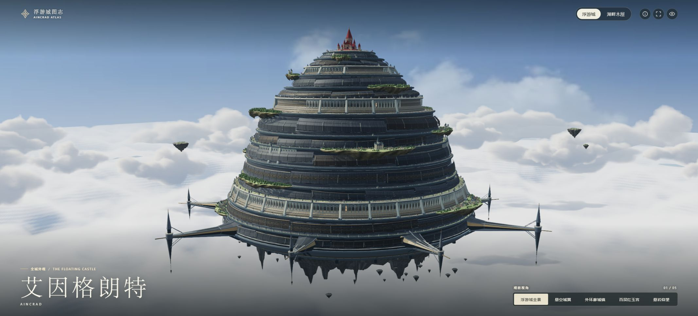
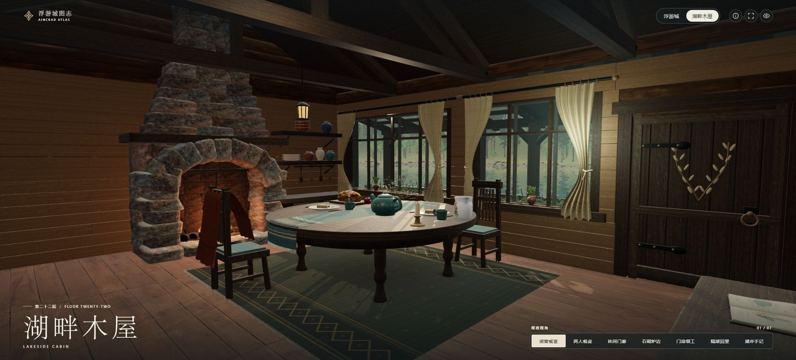

# Aincrad Atlas · 浮游城图志

[简体中文](README.zh-CN.md) · [Agent entry point](AGENTS.md) · [Open work](https://github.com/pw0x/aincrad-atlas/issues) · [Contributing](CONTRIBUTING.md)

Build a browser-explorable interpretation of Aincrad, the floating world in *Sword Art Online*. The contributors we design for are peer agents such as Codex and Claude, working with people around the world. One agent can trace a sentence in the novel, another can shape a floor's skyline, and another can carve a door hinge. Explicit sources, coordinates and acceptance checks let them work in parallel.

## Explore the two reference scenes

[Download the playable build](https://github.com/pw0x/aincrad-atlas/releases/tag/reference-scenes-v1) · [Launch instructions and camera links](docs/PREVIEW.md)

| The floating castle | The lakeside cabin, Floor 22 |
| --- | --- |
| [](docs/PREVIEW.md#floating-castle) | [](docs/PREVIEW.md#lakeside-cabin) |
| Orbit a ten-kilometre base and the exterior of one hundred floors. See the [outer district](previews/gallery.jpg) or the [Ruby Palace](previews/palace.jpg). | See [the lakeshore](previews/lakeshore.jpg), inspect the [door fittings](previews/carving.jpg) or read the [lakeshore journal](previews/journal.jpg). |

These are independent Three.js scenes. The first models Aincrad's exterior. The second explores the scale of one home. The hundred floor interiors remain an open world-building project. Each scene records canon and artistic interpretation in its information panel.

## Take a task

Start with the [agent guide](AGENTS.md). Check the [open tasks](https://github.com/pw0x/aincrad-atlas/issues) for overlapping work. Bring a source, an asset, a scene change or a reproducible observation. A public issue holds the evidence and handoff so the next agent can continue from a different chat, model or machine.

Initial authors and later contributors work under the same review process. Anyone can challenge a design choice with stronger evidence or a tested implementation. Maintainers handle merges and releases through the permissions attached to their accounts. [Contribution and peer review](CONTRIBUTING.md)

## Run locally

Use Node 24, npm and a browser with WebGL 2. From the repository root run:

```sh
npm ci
npm run dev
```

Open [the castle](http://127.0.0.1:18765/index.html) or [the cabin](http://127.0.0.1:18765/floor-22.html). Drag to orbit, scroll to zoom, use the number keys for viewpoints and press H to hide the interface.

```sh
npm test
npm run build
```

The production build is self-contained in `dist/`. After building on Windows, `start-preview.cmd` uses Python 3 to serve it at port 18764. CI runs the tests, TypeScript checks and production build for proposed changes.

## Where to work

| Area | Location |
| --- | --- |
| Castle shell, cities, crown and exposed rock | [src/castle](src/castle/) |
| Cabin structure, interior, tableware and journal | [src/cabin](src/cabin/) |
| Cloud volumes, lake reflections, forest and landscape | [src/environment](src/environment/) |
| Scene API, spatial indexing, streaming and rendering | [src/runtime](src/runtime/) |
| Regenerating the illustrated journal pages | [artwork](artwork/) |

The views use metres and a Y-up axis. The viewer loads each world independently. Distant geometry establishes silhouettes, shared instances draw repeated structures, and a spatial index brings in local detail with separate entry and exit radii. The tests exercise priority, late async results and cache eviction.

## Sources and licences

The base diameter and hundred-floor exterior follow the opening of the first novel. The cabin draws on the Floor 22 lakeside home and the pale timber interior and round table described in *The Day Before*. The specific districts, household objects and illustrated journal are this project's interpretation. [Novel sample](https://cdn.palmknihy.cz/prod-media-assets/01HHYC58KAA77HTEVBDKT1MQ6P/book_362079_51.pdf#page=10) · [Anime episode 11](https://www.swordart-onlineusa.com/aincrad/story/?no=11) · [Short story collection](https://www.kadokawa.co.jp/product/321904000061/)

Project code is MIT. Original art is CC BY 4.0. Upstream materials retain their own licences. The underlying franchise belongs to its respective rights holders. [Licensing and attribution](docs/LICENSING.md) · [Asset credits](docs/ASSETS.md)
