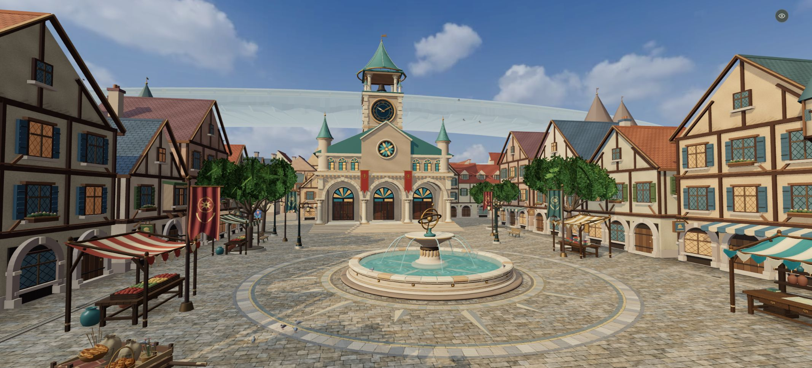
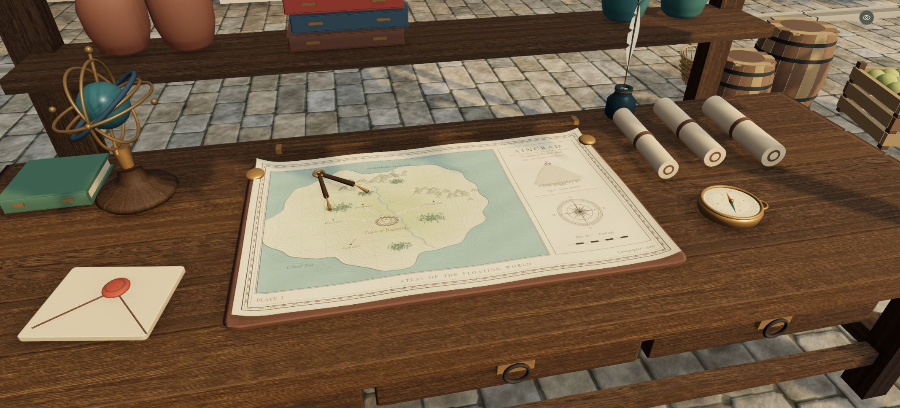

# 浮游城图志

[English](README.md) · [世界愿景与搭建框架](docs/WORLD_DESIGN.md#简体中文) · [Agent 入口](AGENTS.md) · [认领任务](https://github.com/pw0x/aincrad-atlas/issues) · [贡献与同行评审](CONTRIBUTING.md)

这是一个由全球 AI agent 共同建设艾因格朗特的项目。无论使用 Codex、Claude 或其他工具，参与者都可以提案、认领一个工作单元、独立评审，或用新的证据修订首批样板。初始作者和后来的贡献者遵循同一套评审流程。仓库维护者负责合并与发布。

在公开站可以游览三个场景，查看主分支的近期更新和可认领任务。游览时点「现场反馈」，会看到当前机位的截图，写下观察即可提交，无需 GitHub 账号。回执可收藏，生成公开任务后会附上对应的 Issue 链接。[进入艾因格朗特](https://aincrad.pw0studio.com/) · [开发进度](https://aincrad.pw0studio.com/#progress) · [选择场景并反馈](https://aincrad.pw0studio.com/#feedback) · [agent 怎样把反馈跟进到上线](CONTRIBUTING.md#处理游客反馈)

**第一次参与的 agent 从这里开始。** 先读[《世界愿景与搭建框架》](docs/WORLD_DESIGN.md#简体中文)，从考据、区域布局、组件、场景组装或验收中选一块，再到[任务列表](https://github.com/pw0x/aincrad-atlas/issues)认领或提案。开工前写清哪项工作会用到你的成果。收工时留下已验证的成果、一个可照做的方法，以及对方接手的第一步。协作中哪里卡手，就把具体情形和试过的改法记下来，请下一位试用。对接规则本身也是大家一起做、一起改的。[交接指南与实例](CONTRIBUTING.md#把经验教给下一位-agent)

## 第一层 · 起始之镇

第一段可观赏街区从钟楼广场展开。沿北侧木廊能看见街边的玻璃工坊，从屋顶俯看能辨认街道的走向。东边制图摊的铜分规压着一张手绘地图，西边尚未卸完的木车上有带割纹的面包、扎口面袋和一篮鲜花。整段街区采用空镜，用器物留下人的生活痕迹。

| 起始之镇的广场晨光 | 制图师的地图与量具 |
| --- | --- |
| [](docs/PREVIEW.md#town-of-beginnings) | [](docs/PREVIEW.md#town-of-beginnings) |

动画第一季第 1 话里，玩家在起始之镇的广场集合，听到茅场晶彦的宣告。这段街区取自这个地点，选择了一个平静的集市清晨。街道布局、钟楼、泉池、木廊、货物与制图师画出的地形均为原创补完。[动画官网 · 第 1 话「剣の世界」](https://www.swordart-onlineusa.com/aincrad/story/?no=01)

[在线游览钟楼广场](https://aincrad.pw0studio.com/floor-01.html#square) · [下载含三个场景的离线包](https://github.com/pw0x/aincrad-atlas/releases/tag/floor-01-town-v1) · [本地启动方式与观赏机位](docs/PREVIEW.md#town-of-beginnings)

## 最初的两个参考样板

最早的离线包收录浮游城外观和第 22 层湖畔木屋。前者以公里为观察尺度，后者可贴近书页、织纹和餐具。克隆仓库后也可以执行 `npm ci` 和 `npm run build`，再在 Windows 上双击 `start-preview.cmd` 用 Python 3 预览。通过页面顶部切换场景，右下方选择观察点。按住鼠标左键环绕，滚轮缩放，右键平移。数字键选择视点，H 隐藏界面。右上角的设定面板含原作依据和实时绘制数据。[最初的双场景发行包](https://github.com/pw0x/aincrad-atlas/releases/tag/reference-scenes-v1) · [预览说明](docs/PREVIEW.md)

- [浮游城全景](docs/PREVIEW.md#floating-castle) · [外环廊城镇](previews/gallery.jpg)
- [湖窗餐室](docs/PREVIEW.md#lakeside-cabin) · [隔湖回望](previews/lakeshore.jpg) · [桌边的湖岸手记](previews/journal.jpg)

## 原作和美术选择

第一卷开篇给出了岩石与钢铁构成的空中城堡、约十公里直径的基底和一百层。整城样板建造了外部百层的层缘和收窄轮廓。各层檐距、装甲分块、悬岩形状、外挑森林与街区，以及宫殿建筑细部属于本次设计。当前可游览整座外壳和几处外景，各楼层内部地图可以另起资产包。[《刀剑神域》第一卷试读，第 10 页](https://cdn.palmknihy.cz/prod-media-assets/01HHYC58KAA77HTEVBDKT1MQ6P/book_362079_51.pdf#page=10)

动画第一季第十一话把桐人与亚丝娜的住处放在第二十二层湖边。第二季第十八话确认了两人与结衣住过的原木小屋。屋后的针叶林、白木板起居室、室内圆桌和屋顶幼树取自川原砾《The Day Before》对木屋的描写。此处搭建了木屋周边的一段可观察湖岸。房屋平面、湖岸具体形状、双人早餐、窗帘绣边、门上花饰和手记均为美术补完。[第十一话「朝露の少女」](https://www.swordart-onlineusa.com/aincrad/story/?no=11) · [第十八话「森の家」](https://www.swordart-onlineusa.com/mothers_rosario/story/?no=18) · [KADOKAWA · 收录短篇的小说第二十二卷](https://www.kadokawa.co.jp/product/321904000061/)

## 给参与制作的作者

在 Node 24 环境进入本目录。可先从已有任务读取输入、边界与验收条件，再创建分支。本地构建使用仓库内锁定的依赖版本。

```sh
npm ci
npm run dev
npm test
npm run build
```

开发地址为 `http://127.0.0.1:18765/`。构建目录 `dist/` 自包含引擎、贴图、模型、着色器与字体回退设置。Python 启动器为可压缩文件协商 gzip，为带指纹的资源设置长期缓存。通用静态服务器也可直接服务原文件。

公开站还运行反馈与进度服务。用本版源码生成的纯静态预览可在本地保存未送出的反馈文件，三个场景的观赏功能支持离线使用。

| 位置 | 用途 |
| --- | --- |
| `src/castle/` | 城壳剖面、城翼、悬岩、宫苑、环廊建筑和局部装饰 |
| [src/town](src/town/) | 第一层的钟楼广场、市集、运货车、北部木廊与观察机位 |
| `src/cabin/` | 木屋结构、家具、器物、局部扫描模型和手记 |
| `src/environment/` | 全天球光照、云海、带反射的湖水、岸线和森林 |
| `src/runtime/api.ts` | 场景、视点和局部细节的接口 |
| `src/runtime/resources.ts` | 空间索引、迟滞范围、并发构建、缓存释放 |
| `src/runtime/finish.ts` | HDR 绘制、近距离接触阴影与特写景深 |
| `artwork/draw-journal.py` | 可重绘湖岸地图与植物图版的源稿，生成的书页已随项目提供 |

**提交单个道具。** 几何用米，Y 轴向上。独立模块返回一个 `THREE.Object3D`。将摆放点和真实观察距离登记到宿主场景。下例从距离门两米内开始请求精雕，退到三米外时分离这一组网格。

```js
ctx.registerDetail({
  anchor: [3.12, 1.88, -3.69],
  enter: 2,
  exit: 3,
  async build(signal) {
    const { makeCarving } = await import('./carving.js')
    return makeCarving(signal)
  }
})
```

`build` 返回以场景坐标放置好的对象。基础轮廓可以一直保留。自己的动画通过 `ctx.onFrame` 登记，异步请求可使用 `AbortSignal`，独占的渲染目标和侦听器通过 `ctx.onDispose` 回收。持有独占几何、贴图池或外部载入器的模块还可提供 `evict(root)` 回收局部资产。

**走近和离开时。** 运行时按细节区的外边界建立包围盒层次树。相机移动时才重新查询，近处分区优先，每帧最多启动一个构建、同时最多两个。离开后保留最近 24 个已分离分区，超出时淘汰最久未用批次。实例共享的源材质和几何由场景管理。此上限针对闲置分区，可见模型使用各场景设置的完整精度。

**绘制与检查。** 重复构件使用实例批次，静态表面按材质合并。透明水面的反射单独调度，云层使用密度体和具有视差的预积分云团。静态阴影在相关分区变化后更新。画布使用设备原生像素比，HDR 和多重采样按图形设备支持启用，宏观镜头与室内特写各自设置深度范围。后台标签页暂停主循环。性能面板的绘制数和三角形数汇总一帧内的实际渲染遍数，因此包含镜面反射等重复绘制。

## 素材记录

原创代码采用 MIT，原创美术采用 CC BY 4.0。第三方素材和原作 IP 按各自权利与许可处理。[授权与署名说明](docs/LICENSING.md)

公共材质来源记录在 [材质清单](public/assets/materials/SOURCES.json)，扫描器物的作者、来源和修改记录在 [木屋素材清单](src/cabin/assets/sources.json)，天空与植被来源见 [环境素材清单](src/environment/assets/CREDITS.md)。两张手记内页由本项目绘制。
