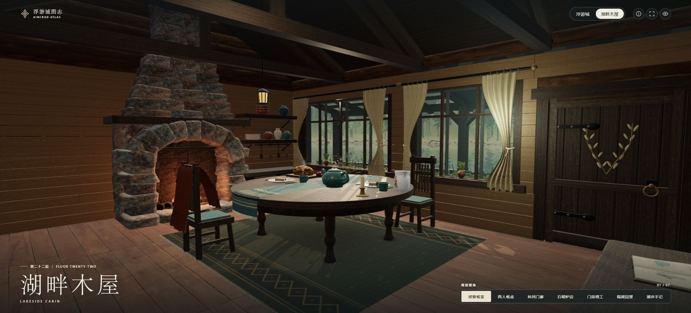

# Viewing the reference scenes · 场景预览

Use the [reference release](https://github.com/pw0x/aincrad-atlas/releases/tag/reference-scenes-v1) to download the prebuilt atlas and its SHA-256 checksum. Extract the ZIP. On Windows with Python 3, double-click `start-preview.cmd`. On macOS or Linux, run `python3 preview.py --open` from the extracted folder. This build contains both worlds and their assets. A source checkout can also run the scenes with `npm ci` and `npm run dev`.

从[参考场景发行页](https://github.com/pw0x/aincrad-atlas/releases/tag/reference-scenes-v1)下载并解压预览包。Windows 装有 Python 3 时可直接双击 `start-preview.cmd`。macOS 或 Linux 在解压目录执行 `python3 preview.py --open`。下方本机链接与这个预览包配套，源码开发服务器使用端口 18765。

## Floating castle

[Orbit the castle](http://127.0.0.1:18764/index.html) · [Outer district](http://127.0.0.1:18764/index.html#gallery) · [Ruby Palace](http://127.0.0.1:18764/index.html#palace)

## Lakeside cabin

[Dining room](http://127.0.0.1:18764/floor-22.html) · [Across the lake](http://127.0.0.1:18764/floor-22.html#lakeshore) · [Door fittings](http://127.0.0.1:18764/floor-22.html#carving) · [Field journal](http://127.0.0.1:18764/floor-22.html#field-notes)

## Hosted preview

The Pages deployment currently inherits an unavailable domain from the repository owner's account. The downloadable build above works independently of that domain. [Deployment history](https://github.com/pw0x/aincrad-atlas/actions/workflows/pages.yml)
